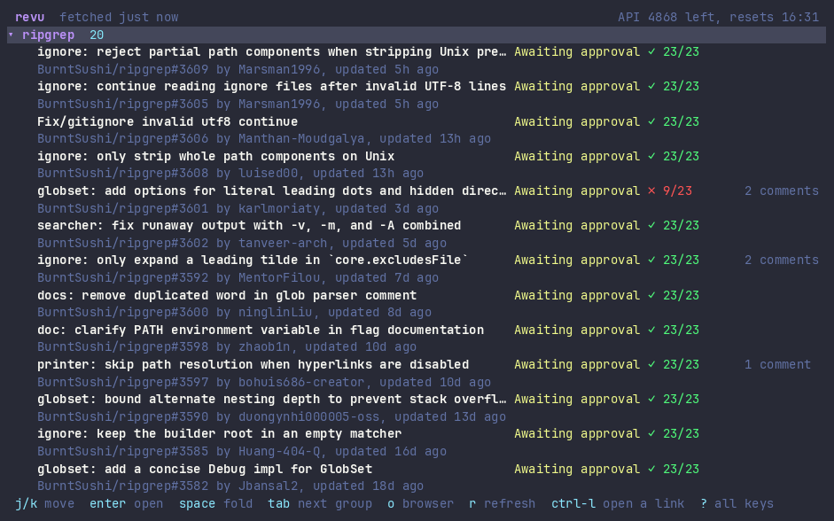

# revu

Your GitHub pull requests, reviewed in the terminal. revu collects the pull requests that wait on you across every repository, opens each one the way GitHub's Overview does, and shows the diff in word diff, delta or difftastic. You can review, comment on lines, reply to threads and label without opening the browser.



## Install

revu runs on macOS and Linux. It needs the GitHub CLI (`gh`), logged in, git, and `curl` to show images.

```bash
curl -fsSL https://cjhwong.github.io/revu/install.sh | sh
```

The script installs the latest release to `~/.local/bin`, after checking its checksum. Set `REVU_INSTALL_DIR` to pick another folder. Or:

```bash
brew install CJHwong/tap/revu                        # Homebrew
cargo install --git https://github.com/CJHwong/revu  # from source, with Rust
```

The first run writes `~/.config/revu/config.yaml`. Set `workspace_dir` in it to the folder, or a list of folders, that holds your clones, so the diffs can load.

## Documentation

- [Getting started](docs/getting-started.md): a first session, from install to a submitted review.
- [How-to guides](docs/how-to.md): set up your inbox, add a diff view, review a pull request, fix common errors.
- [Keys](docs/keys.md): every key, by where it works. Press `?` in the app for the same list.
- [Configuration](docs/configuration.md): every setting in `config.yaml` and `view.yaml`.
- [How it works](docs/how-it-works.md): local clones, what revu writes to GitHub, the API budget, and error handling.

## License

MIT. See [LICENSE](LICENSE).
